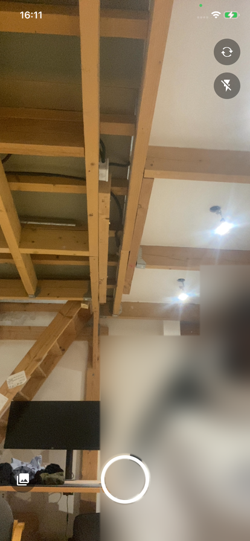
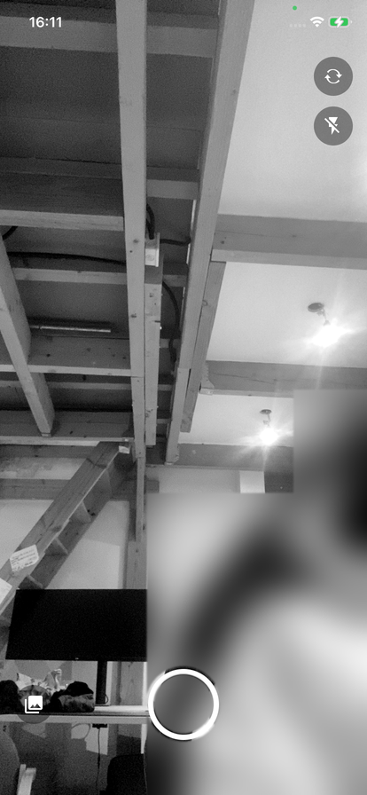
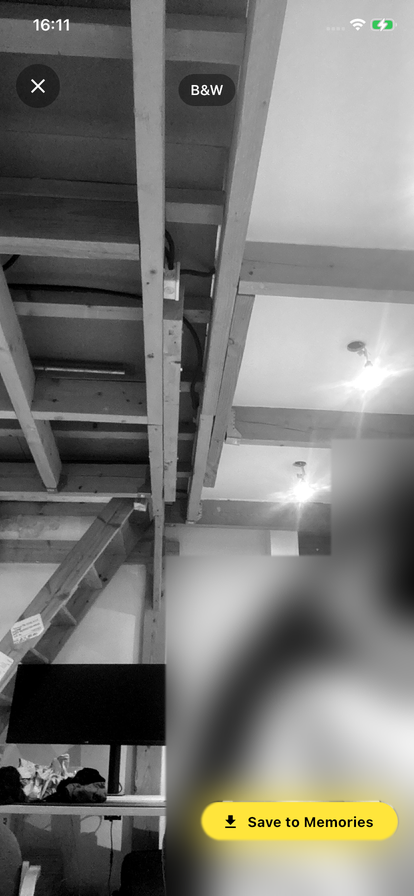
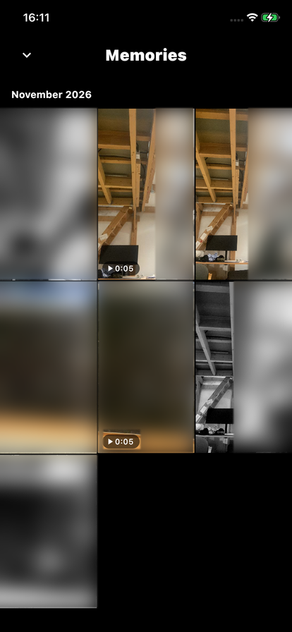
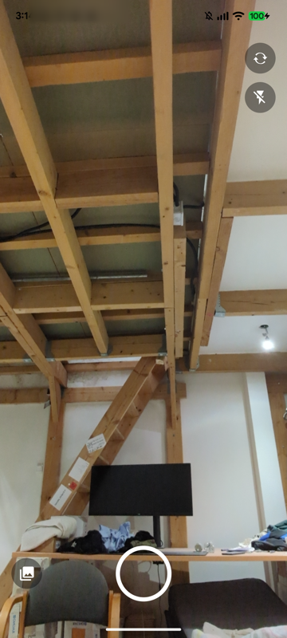
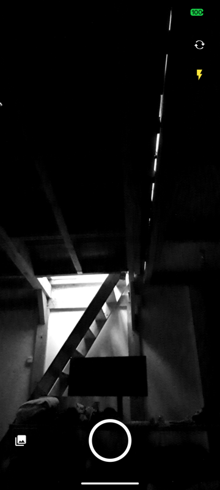
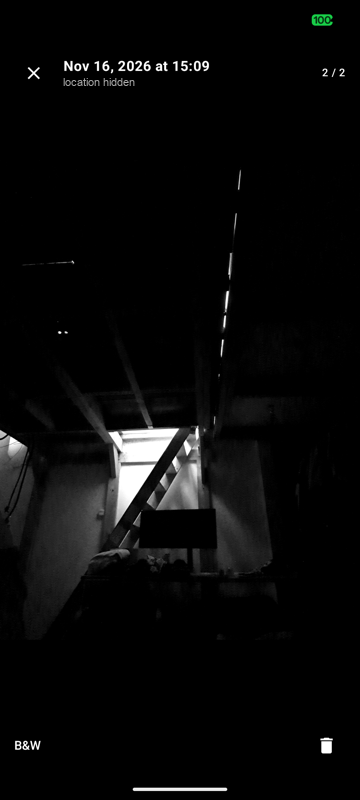
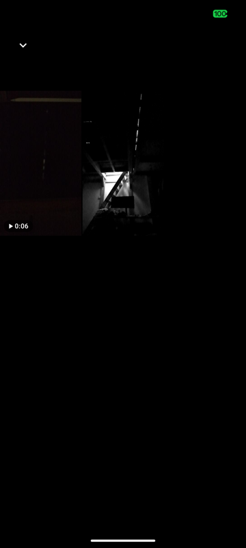

# Snap Clone KMP

[](https://github.com/nathanfallet/snapchat-clone-kmp/actions/workflows/build.yml)
[](LICENSE)

> **This is a technical demo of [KMP Vision Camera](https://github.com/nathanfallet/kmp-vision-camera)**, the Kotlin
> Multiplatform port of React Native VisionCamera. It shows what the library can do in a real app: a Snapchat-like
> camera with its gestures and live filters, and a local Memories gallery, for **Android and iOS**, written once in
> Kotlin with Compose Multiplatform.

It is not a product: there is no account, no server, no sharing. Photos and videos stay on the device.

## Screenshots

| Camera | Live filter | Snap preview | Memories |
| --- | --- | --- | --- |
|  |  |  |  |
|  |  |  |  |

Top row: iPhone 11 (front camera). Bottom row: Pixel 7a (the filter and viewer shots were taken in a dark room, with the flash on). People, screens and locations are blurred or hidden. The iPhone shots use the front camera orientation fix of [kmp-vision-camera#1](https://github.com/nathanfallet/kmp-vision-camera/pull/1), coming in the next release of the library.

## Features

The camera screen:

* **Tap the shutter** to take a photo, **hold it** to record a video (up to 60 seconds, with a progress ring), and
  **slide your finger up** while holding to zoom, like in Snapchat.
* **Pinch** to zoom, **double tap** to flip between the front and back cameras, **tap** to focus.
* **Swipe left or right** to change the live filter: Normal, B&W, Vintage, Golden, Arctic, Vivid, Pixels and
  Negative. They are SkSL shaders drawn on every camera frame with Skia, and the same shader is applied to the
  full-resolution photo.
* **Flash**: the flash of the back camera, or a white "screen flash" on the front camera.
* **Night mode**: the low-light boost, on devices that support it.
* **Long press** to scan a QR code, and open its link.
* **Swipe up** (or tap the Memories button) to open the Memories.

After a capture, the snap is previewed (the filtered photo, or the video playing in a loop), to **save it to the
Memories** or discard it.

The Memories show the saved snaps newest first, grouped by month. A snap opens full screen, where you can swipe between
them, play videos, see when and where they were taken, and delete them.

## KMP Vision Camera APIs used

| Feature | KMP Vision Camera API |
|---|---|
| Camera preview with live filters | `SkiaCamera` (skia-compose), drawing each `Frame` with a Skia `RuntimeEffect` (SkSL) |
| Photos | `rememberPhotoOutput`, `CameraPhotoOutput.capturePhoto`, `Photo.saveToTemporaryFile` |
| Videos (hold the shutter, 60 s max) | `rememberVideoOutput`, `CameraVideoOutput.createRecorder`, `RecorderSettings(maxDuration)`, `Recorder` |
| Pinch and slide-to-zoom | `CameraController.setZoom`, `minZoom`, `maxZoom` |
| Tap to focus | `SkiaCameraRef.focusTo` |
| Flip camera | `rememberCameraDevice(TargetCameraPosition.FRONT / BACK)` |
| Flash | `CapturePhotoSettings(flashMode)`, `CameraDevice.hasFlash` |
| Night mode | `CameraControllerConfiguration(enableLowLightBoost)`, `CameraDevice.supportsLowLightBoost` |
| QR code scan (long press) | `rememberBarcodeScanner` (barcode-compose) and `BarcodeScanner.scanCodes` on the `SkiaCamera` frames |
| Location of the snaps | `rememberLocation` (location-compose), `CapturePhotoSettings(location)`, `RecorderSettings(location)` |
| Video thumbnails | `SkiaCameraRef.takeSnapshot` |
| Permissions | `rememberCameraPermission`, `rememberMicrophonePermission`, `LocationState.requestPermission` |

## Known limits

* **Videos are recorded without filter.** The video output records the camera stream, not what Skia draws, exactly
  like VisionCamera V5's `<SkiaCamera />`: filters apply to the preview and to photos. Recording the Skia render would
  need a custom encoder (feeding the rendered frames to `MediaCodec` / `AVAssetWriter`), which is out of the scope of
  this demo. So that what you see is what is recorded, the preview drops the filter while recording (and the filter
  can't be changed then); the thumbnail of a video is a snapshot of that unfiltered preview.
* Filters are rendered on the CPU for photos (a 12 MP photo takes a moment on older phones).

## Running the app

Requirements: JDK 21, Android Studio (or the Android SDK) for Android, a Mac with Xcode for iOS.

**Android** (Android 9 or newer, `arm64-v8a` or `x86_64`):

```bash
./gradlew :androidApp:installDebug
```

**iOS**: open `iosApp/iosApp.xcodeproj` in Xcode, choose your team in *Signing & Capabilities*, and run on an iPhone
(the camera needs a real device). Xcode builds the Kotlin framework with Gradle.

Tests and checks:

```bash
./gradlew testAndroidHostTest detekt        # unit tests (Android host) and static analysis
./gradlew iosSimulatorArm64Test             # unit tests on the iOS Simulator (macOS)
```

## Architecture

The app follows a clean architecture, in Gradle modules whose dependencies point inwards:

```
androidApp / iosFramework     (entry points: Koin assembly)
        │
        ├── presentation ───► domain ◄─── data
        │   (Compose UI,       (models,      (repositories:
        │    ViewModels,        use cases,    files + JSON
        │    KMP Vision Camera) interfaces)   index, okio)
```

* **`domain`**: pure Kotlin Multiplatform, no Compose, no camera, no file system. Models (`Memory`, `MemoryDraft`,
  `Filter`, `GeoPoint`, `ScannedCode`…), repository interfaces (`MemoriesRepository`, `CapturesRepository`) and use
  cases (`GetMemoriesUseCase`, `SaveMemoryUseCase`, `DeleteMemoryUseCase`, `ReadCaptureUseCase`,
  `DiscardCaptureUseCase`, each an interface and its `Impl`).
* **`data`**: `MemoriesRepositoryImpl` stores the media files in the app's private directory (`filesDir` on Android,
  Application Support on iOS) with a JSON index (kotlinx-serialization), through okio. `CapturesRepositoryImpl` reads
  and deletes the camera's temporary files.
* **`presentation`**: Compose Multiplatform screens and their ViewModels (JetBrains' multiplatform
  lifecycle-viewmodel), with immutable UI states. It is the only module using KMP Vision Camera. The camera objects
  live in the composition; the ViewModels decide when to capture and what to do with the result, so they are tested
  without a camera. A small `expect`/`actual` plays videos (Media3 ExoPlayer on Android, AVPlayer on iOS).
* **`androidApp`** and **`iosFramework`**: the entry points, which start Koin with the modules of the three layers.
  `iosFramework` builds the `SnapClone` framework that the Xcode project in **`iosApp`** links.

Dependency injection uses [Koin](https://insert-koin.io), with one module per layer.

## Credits

* [KMP Vision Camera](https://github.com/nathanfallet/kmp-vision-camera), a port of
  [React Native VisionCamera](https://github.com/mrousavy/react-native-vision-camera) by Marc Rousavy.
* [Skiko](https://github.com/JetBrains/skiko) (Skia for Kotlin), [Coil](https://coil-kt.github.io/coil/),
  [Koin](https://insert-koin.io), [okio](https://square.github.io/okio/), and Media3.
* Most icons are paths from Google's [Material Icons](https://fonts.google.com/icons) (Apache License 2.0).

## Disclaimer

This project is not affiliated with, endorsed by, or connected to Snap Inc. Snapchat is a trademark of Snap Inc. This
app uses none of Snap Inc.'s logos or assets: it only reproduces the interactions of a camera app, for demonstration
purposes.

## License

Snap Clone KMP is licensed under the [Apache License 2.0](LICENSE).
